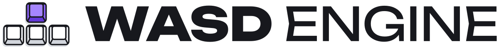
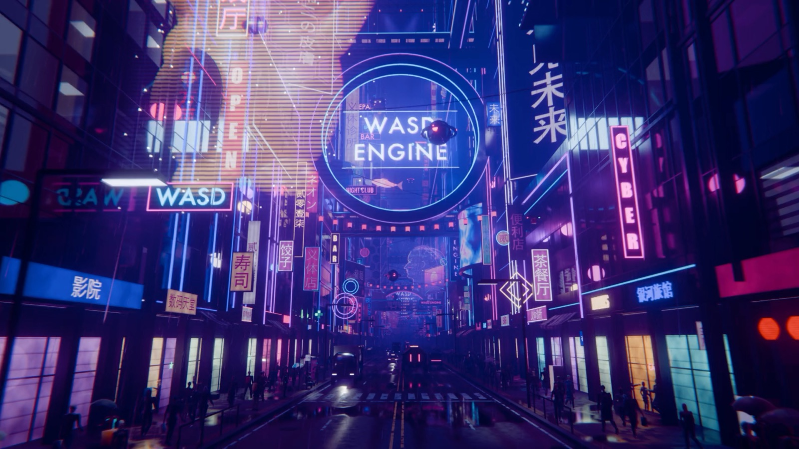
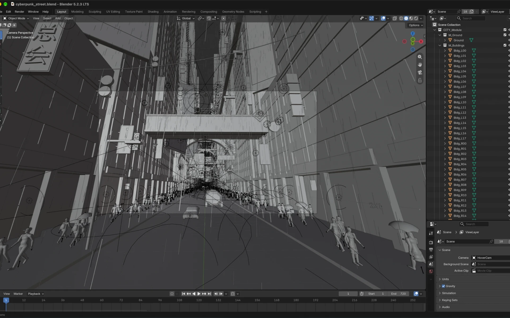
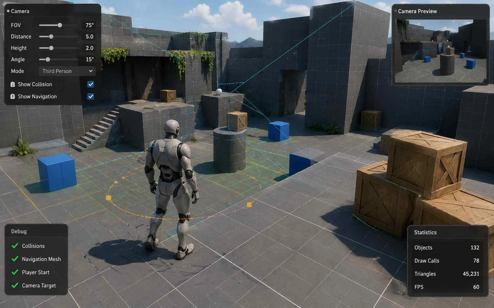

<p align="center">
  <picture>
    <source media="(prefers-color-scheme: dark)" srcset="readme/wasd-engine-logo-for-dark-bg.svg">
    
  </picture>
</p>

<h3 align="center">The Ultimate Open-Source Harness for AI Game Dev</h3>

<p align="center">
  WASD Engine bundles
   <b>Godot Engine</b>,
   <b>Blender</b>,
   <b>GIMP</b>, and
   <b>SuperCollider</b>
  into a single open-source agent harness.
</p>

<p align="center">
  <a href="https://github.com/WASDEngine/WASD-Engine/releases/latest"><b>Download for macOS or Windows</b></a>
  &nbsp;·&nbsp;
  <a href="https://app.wasdengine.com">Website</a>
  &nbsp;·&nbsp;
  <a href="#run-from-source">Run from source</a>
</p>

<p align="center"><sub>Pronounced "WAHZ'D" Engine.</sub></p>



## A harness built for game dev

WASD Engine bundles everything you need to build high-polish games in a single agent harness, so your agents can build from start to finish. Describe the game you want, and the agent plans it, writes the code, makes the models, textures, music, and sound effects, then plays the game to check its own work.

<table>
  <tr>
    <td width="72" align="center"></td>
    <td><b>Godot 4</b><br>WASD Engine is powered by Godot 4 under the hood. Your agent fully play-tests and diagnoses your game, which speeds up every development loop.</td>
  </tr>
  <tr>
    <td align="center"></td>
    <td><b>Blender</b><br>3D modeling, rigging, and animation for the models your game needs. WASD Engine ships with a fully capable AI 3D artist.</td>
  </tr>
  <tr>
    <td align="center"></td>
    <td><b>GIMP</b><br>Image editing and texture painting for your sprites, textures, and UI, so your agent can hand-paint natural-looking art.</td>
  </tr>
  <tr>
    <td align="center"></td>
    <td><b>SuperCollider</b><br>Audio synthesis and algorithmic composition for your game's music and sound effects. Your agent composes original scores and designs custom SFX.</td>
  </tr>
</table>

Godot is built into the Desktop app, and so are SuperCollider and GIMP on macOS. Blender sets itself up the first time the agent uses it, or uses the Blender you already have, and elsewhere the GIMP tools use your GIMP 3.

## Agents fill every game dev role

WASD Engine orchestrates agents to create art, music, and game logic, so your vision comes to life faster.

<table>
  <tr>
    <td width="50%" valign="top">
      
      <p><sub>QUALITY 2D &amp; 3D ART</sub><br><b>Agents use real game dev tools.</b><br>WASD Engine creates art with the same tools game studios use, instead of sloppy AI-generated images and models.</p>
    </td>
    <td width="50%" valign="top">
      
      <p><sub>FULL DEV LIFECYCLE</sub><br><b>Agents automate testing.</b><br>WASD Engine lets your agent play your game, run diagnostics, and read the logs, to produce higher-quality one-shots.</p>
    </td>
  </tr>
</table>

## Built from plugins. Shaped by you.

Every capability in WASD Engine is a plugin. Use it as a complete workbench, or reshape it one piece at a time.

<table>
  <tr>
    <td width="33%" valign="top"><sub>THE APP</sub><br><b>Desktop</b><br>Sessions, game projects, and your game's files in one window.</td>
    <td width="33%" valign="top"><sub>THE ENGINE</sub><br><b>Godot</b><br>Run, play-test, and debug your game in Godot 4, without installing Godot.</td>
    <td width="33%" valign="top"><sub>THE 3D STUDIO</sub><br><b>Blender</b><br>Model, rig, and animate your game's 3D assets, driven by your agent.</td>
  </tr>
  <tr>
    <td valign="top"><sub>THE AGENT</sub><br><b>Sessions</b><br>Conversations that plan, edit, and test inside your project, one step at a time.</td>
    <td valign="top"><sub>THE KNOW-HOW</sub><br><b>Skills</b><br>Instructions the agent loads when it needs them, from game recipes to your own rules.</td>
    <td valign="top"><sub>THE ROLES</sub><br><b>Presets</b><br>Starting points like Game developer that set the agent's tools and focus.</td>
  </tr>
  <tr>
    <td valign="top"><sub>THE EXTENSIONS</sub><br><b>Plugins</b><br>Tools, panels, and providers you can add, swap, or write yourself.</td>
    <td valign="top"><sub>THE CONNECTION</sub><br><b>Gateway</b><br>Model calls through your WASD Engine account, with no provider key to manage.</td>
    <td valign="top"><sub>YOUR OWN</sub><br><b>Customize</b><br>Create your own plugins by simply asking WASD Engine.</td>
  </tr>
</table>

## Works with any agent

Connect your existing subscription to WASD Engine for free using MCP. WASD Engine runs an MCP server on your computer that gives Claude Code, Codex, or any other agent the same game tools, and the games it builds play in the WASD Engine window. Bring the agent you already pay for, whether it runs on ChatGPT, Claude, Gemini, Grok, MiniMax, DeepSeek, Kimi, or GLM.

To connect one, open the sign-in dialog in WASD Engine, choose **Set up with another agent**, and paste the prompt it gives you into your agent.

## Plans

| Free · $0/month | Pro · $10/month | Max · $40/month |
|---|---|---|
| Open source | Built-in game dev AI | Everything in Pro |
| Bring your own AI | Generous weekly usage limits | Highest weekly usage limits |
| 2D & 3D assets, music, SFX, and more | Create AAA-quality games | For the most ambitious creators |

See the [website](https://app.wasdengine.com) for current plans.

## Under the hood

- **A real game engine in the loop.** The Desktop app ships a patched LibGodot runtime. The agent runs each Session's game as its own process, gets its screenshots, logs, and errors back, sends it input, and streams it to the Game tab, where you can play it too.
- **Creative tools without the windows.** Blender, GIMP, and SuperCollider run headless behind MCP servers. The agent looks at its work through rendered previews, snapshots, and audio analysis with waveform and spectrogram images, and exports glTF models, textures, sprite sheets, and audio files into your project.
- **Game projects with Git built in.** Each game project is a folder under `Documents/WASD Engine` with its own Git repository. Turn on Change requests & worktrees, and parallel Sessions each work on their own branch in a Git worktree, so they never overwrite each other.
- **Game know-how out of the box.** New Sessions use the Game developer preset with skills for Godot 4 (`godot-project`), Phaser (`phaser-game`), and design planning (`game-design-doc`). A skill directory with the same name under `.agents/skills/` or `.dsh/skills/` in your project replaces the bundled copy, so a team can pin its own engine conventions.
- **Every piece is a plugin.** WASD Engine is built on the Cordis plugin architecture of DeepSeek Harness: every tool, panel, and provider is a plugin row in a profile, and the Plugins page switches the game tools on and off.
- **Private by default.** Model requests carry no copy of your Session log unless you turn the Session log option on in Settings, and product analytics and telemetry exports are off. Sessions, settings, and credentials stay in `~/.wasdengine`.
- **Desktop, browser, or terminal.** Use the Desktop app, the Web UI (`dsh web`), or the `dsh` command line, including `dsh acp` for editors and `dsh sdk` for SDK clients.

## Run from source

Install Node.js 24.9 or later and pnpm 11.28.5. Node.js 25 and later ship without Corepack, so install pnpm with `npm install -g pnpm@11.28.5`. Then run:

```sh
git clone https://github.com/WASDEngine/WASD-Engine.git
cd WASDEngine
pnpm install
pnpm run build
pnpm dsh web
```

`pnpm dsh web` serves the Web UI at `http://127.0.0.1:3080` and opens it in the default browser; pass `--no-open` to skip the browser. `pnpm run dev:desktop` builds and starts the Desktop app from the same checkout. `pnpm run package:desktop:mac:arm64:unsigned` builds an unsigned `WASD Engine.app` and disk image for Apple silicon Macs; add `--dir` to stop at the app.

Data lives in `~/.wasdengine` unless `DSH_HOME` names another directory.

<details>
<summary>Moving over from DeepSeek Harness</summary>

To keep your Sessions from a DeepSeek Harness install, copy the `sessions` and `attachments` directories of `~/.dsh` into `~/.wasdengine`, and `storages` too if you want its workspace list and scheduled tasks. Do not copy its `profiles` directory, `cordis.patch.yml`, `settings.yaml`, or `.credentials.yaml`, and do not set `DSH_HOME` to `~/.dsh`: the configuration files replace the WASD Engine service settings with DeepSeek's, `.credentials.yaml` holds DeepSeek Harness's keys and sign-in, and in a shared home each product deletes the other's sign-in at startup.

</details>

## Connect to the WASD Engine service

The Web UI and the Desktop app sign in with a WASD Engine account and ask for no other credential: choose **Sign in** in the Get started dialog or in the account menu at the bottom of the sidebar. The harness opens the WASD Engine sign-in page in your browser and stores the resulting token locally. Profiles that use the same harness home share the stored sign-in. The default model is `deepseek-flash` (DeepSeek-V4.1-Flash), served through the service.

Scripts and SDK clients can use a WASD Engine API token instead: create one on the account page and export it as `WASDENGINE_API_KEY` in the environment that starts the harness. `dsh acp` sends model requests with the API token. An SDK client selects the route in its `initialize` request: provider `deepseek-account` uses the sign-in, and `deepseek-official` uses the API token. `dsh --profile headless` and `dsh --profile sdk-minimal` keep no credential store, so they read the token from the `WASDENGINE_API_KEY` environment variable.

<details>
<summary>Use another deployment of the service</summary>

The harness signs in at `https://app.wasdengine.com` and sends model, web search, and file requests to `https://api.wasdengine.com`. To use another deployment, such as a WASD Engine service running on your machine, set `WASDENGINE_ORIGIN` in the environment that launches the harness; it replaces both origins:

```sh
WASDENGINE_ORIGIN=http://127.0.0.1:8000 pnpm dsh web
```

The Desktop app reads `WASDENGINE_ORIGIN` from its launch environment first and from the `.env` file of the harness home (`~/.wasdengine/.env` unless `DSH_HOME` points elsewhere) second. On macOS that launch environment includes the variables your login shell exports, for example from `~/.zshrc` or `~/.zprofile`, even when the app starts from the Finder; on Windows, an app started from the Start menu sees your user and system environment variables but not variables set in a terminal. To point the Desktop app at another deployment, put the line `WASDENGINE_ORIGIN=http://127.0.0.1:8000` in that `.env` file, and remove any `WASDENGINE_ORIGIN` export from your shell startup files or your Windows environment variables, because those take precedence over the file. A `.env` file in a project directory cannot set it, so a cloned repository cannot redirect your WASD Engine credentials. Origins other than `localhost`, `127.0.0.1`, and `[::1]` must use HTTPS.

</details>

## Built on DeepSeek Harness

WASD Engine is a fork of [DeepSeek Harness](https://github.com/deepseek-ai/deepseek-harness). It is an independent project, not affiliated with, endorsed by, or sponsored by DeepSeek. This page uses the DeepSeek and DeepSeek Harness names only to describe the project WASD Engine is built on, the DeepSeek services the fork turns off or replaces, the DeepSeek model it serves, and DeepSeek among the AI providers whose agents can connect; interface text inherited from DeepSeek Harness still names DeepSeek in the places [listed below](#interface-text-that-names-deepseek). As the DeepSeek Harness [brand guidelines](../BRAND_GUIDELINES.md) state, "DeepSeek Harness" is a registered trademark of DeepSeek. Other product names on this page are trademarks of their owners, and WASD Engine is not affiliated with them.

<details>
<summary>What the fork changes</summary>

- **WASD Engine service by default.** Model requests, web search, and account sign-in go to the WASD Engine service instead of DeepSeek from every `dsh` profile: the Web UI (`dsh web`), the Desktop app, `dsh acp`, `dsh sdk` and the SDK clients that launch it, `dsh --profile headless`, and `dsh --profile sdk-minimal`.
- **Game development by default in the Web UI and the Desktop app.** New Sessions there use the Game developer preset and the game tools, and the upstream presets, including Standard, remain available. The preset and its skills ship in the Web bundle `@deepseek-ai/dsh-web-app`, which no other shipped profile loads, so `dsh acp`, `dsh sdk`, `dsh --profile headless`, and `dsh --profile sdk-minimal` keep upstream's agent without them.
- **Game projects instead of Workspaces.** The Web UI and the Desktop app call Workspaces game projects and create no default one: on first use a dialog asks for a game project, creates its folder with a Git repository, or opens an existing folder, and the sidebar's New game project opens the same dialog.
- **No upstream CI.** The fork deletes upstream's GitHub Actions workflows, Dependabot configuration, and the specs that read them ([wasdengine/upstream-prune.txt](../wasdengine/upstream-prune.txt)), because they target DeepSeek's runners and release channels.
- **No transcript or analytics uploads.** Model requests from every profile carry no copy of the Session log (`dsh_session_log`) unless a user turns the Session log option on in Settings, and the Session OpenTelemetry export and Desktop product analytics, which report to DeepSeek's collector, are switched off.
- **Its own identity and data.** The Web UI and the Desktop app show the WASD keycap mark instead of DeepSeek's whale in the sidebar, beside the home headline, in the home's click animation, in the chat's running status, and as the browser tab icon, and the Web UI installs from the browser as an app named WASDEngine with the keycap icon. The Desktop app is called WASD Engine and has its own icon, bundle identifier (`com.wasdengine.desktop`), deep link (`wasdengine://open`), and application data folder; its first-run welcome and onboarding introduce WASD Engine for game development, the Web UI opens without DeepSeek Harness's preview notice, and the sign-in and account text names WASD Engine accounts. WASD Engine keeps its data in `~/.wasdengine`, so it can be installed next to DeepSeek Harness (`~/.dsh`) without either reading the other's data; only the optional LiveShare plugin keeps its files in `~/.dsh/liveshare/` (see the [known limitations](../wasdengine/FORK.md#known-limitations)). WASD Engine builds never update themselves from DeepSeek's download server.

The service and agent changes are configuration, the game tools are fork-owned packages in [`packages/gamedev/`](../packages/gamedev/README.md), and the identity is a Desktop brand module, brand occupants for the Web UI, and copy rewrites of client dictionaries; [wasdengine/FORK.md](../wasdengine/FORK.md) lists every file the fork adds or modifies and how upstream releases are merged.

</details>

### Interface text that names DeepSeek

Some interface text inherited from DeepSeek Harness still names DeepSeek, although sign-in, model, and search requests go to the WASD Engine service:

- The model menu, which calls the provider DeepSeek and the sign-in route DeepSeek Account.
- The web search providers DeepSeek Search API, DeepSeek Fetch API, and DeepSeek (legacy), the Session log option "Help improve DeepSeek models and products", and chat errors about the account sign-in.

The optional LiveShare viewer page shows DeepSeek's whale as its sidebar mark.

## License

WASD Engine is distributed under the GNU General Public License, version 3 only (`GPL-3.0-only`), in [LICENSE](../LICENSE). It is a fork of DeepSeek Harness, whose MIT License and copyright notice the fork keeps in [wasdengine/deepseek-harness-MIT.txt](../wasdengine/deepseek-harness-MIT.txt). Third-party dependencies and their licenses are listed in [THIRD_PARTY_NOTICES.md](../THIRD_PARTY_NOTICES.md).

The tool logos are not covered by this repository's license. The Godot logo is by Andrea Calabró, under [CC BY 4.0](https://creativecommons.org/licenses/by/4.0/). Blender and the Blender logo are trademarks of the Blender Foundation. Wilber, the GIMP logo, is by Aryeom Han, under [CC BY-SA 4.0](https://creativecommons.org/licenses/by-sa/4.0/). The SuperCollider logo is by Nathan Ho, under the [GPL-3.0](https://www.gnu.org/licenses/gpl-3.0.html). Each logo's `icon.svg` under [`packages/gamedev/`](../packages/gamedev/README.md) carries its full credit and terms.
